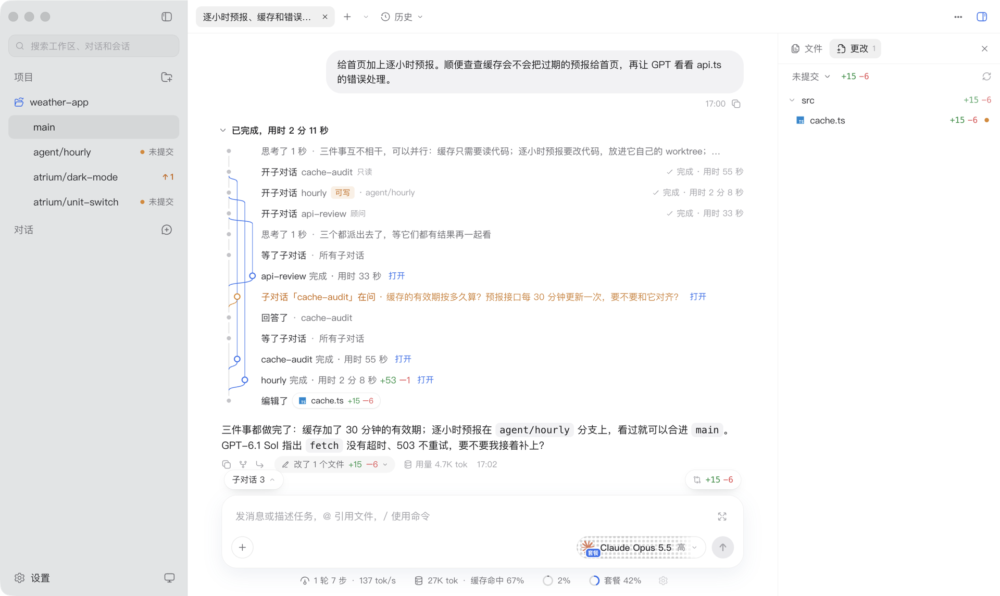
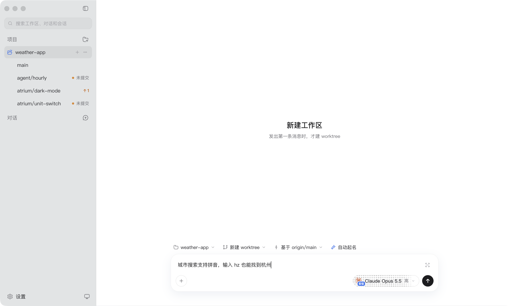
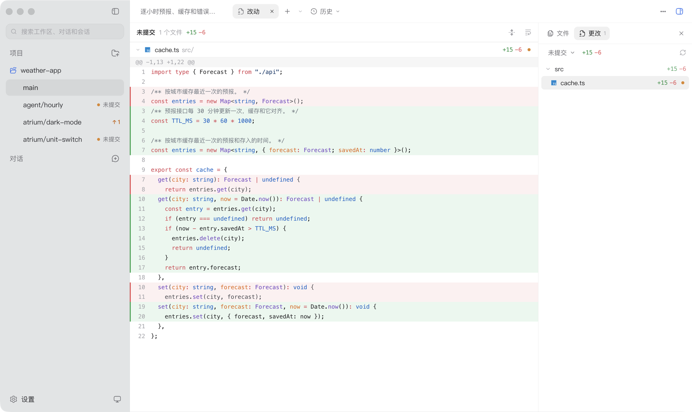

# Atrium

> 以 [pi](https://github.com/earendil-works/pi) 为内核的 macOS 编码 agent 桌面端：先把每天写代码这件事做顺手，再把 agent 的内部机制变成看得见、能操作的界面。

<picture>
  <source media="(prefers-color-scheme: dark)" srcset="docs/images/workbench-dark.png">
  
</picture>

Atrium 的形态和 Codex 桌面端差不多：左边是项目和工作区，中间和 agent 对话，右边看文件和改动。不一样的地方在于它只接一个 agent，也就是 pi，并且打算往深里做：会话树、上下文检查器、工具调用拦截这些只有吃透 agent loop 才做得出来的界面，是它后面要做的事。

现在先做给自己日常写代码用，以后开源。

## 现在能做什么

**对话与过程**

- 流式显示回复，Markdown、代码块（Shiki 上色）、表格都按阅读排版
- agent 读了什么、改了什么、跑了什么命令，按步骤排成一条过程轨道，运行中展开，结束后折进这一轮的标题；每一步都能点开看详情和 diff
- 运行中可以排队下一条消息、插话、停止；pi 要你确认或回答时弹出对话框卡片；出错有错误卡片和"重试"
- 输入框里 `@` 引用文件、`/` 用命令，能粘贴、拖入图片，长文本粘贴后折叠；草稿按会话保留

**项目、工作区与会话**

- 一个项目下的每个 git worktree 是一个工作区，侧栏标出未提交、领先几个提交、是否已合并进主干
- 新建工作区时直接写第一条消息，模型按这条消息给分支起名，再建 worktree、开会话
- 多个会话并行跑，标签栏 ⌘1–9 切换；需要你的会话进收件箱
- 会话可以交给终端里的 pi 接着做，做完再接回来；终端里 pi 的历史会话也能在"历史"里找到、打开
- 会话自动起标题；不用的 worktree 可以归档（删目录、留分支），之后再恢复



**子对话**（[SPEC-0002](docs/specs/0002-child-conversations.md)）

- 从回复下方的"↳"、标签栏"+"旁的菜单或 `/child` 开子对话：可以带上到这一轮为止的对话，也可以开个空的；放在当前工作区，或从当前的提交新建一个 worktree
- 主对话的 agent 也能自己开子对话，分三种角色：只读（查东西）、可写（在自己的 worktree 和 `agent/…` 分支上改）、顾问（只读，可以换个模型来审）。子对话默认在后台跑，做完通知主 agent，也可以等齐了再汇总；拿不准时可以问主 agent，由主 agent 回答；要你回答的照常进收件箱。agent 开的最多两层，每个主对话同时最多 6 个
- 过程轨道上每个子对话一条车道：从"开子对话"那一步分出去，有了结果从右边合回主线，写"完成 · 用时"，可写的还带上改动的行数；子对话问主 agent 也画在轨道上
- 输入框上方的子对话条汇总各子对话的状态，点开列出角色、进度和正在问主 agent 的问题；子对话的标签带"↳"和面包屑，一步回到主对话
- 主对话的状态栏把子对话的 token 和费用一起算进"含子对话"；归档主对话时，同一工作区的子对话一起收好


**改动与文件**

- 右栏"文件""更改"两个标签：浏览工作区的文件树，看未提交或相对主干的改动
- 点开文件或改动，在对话区的标签页里看完整内容和 diff，几万行的 diff 也能顺畅滚动



**模型与状态**

- 模型和推理强度按会话选，记住每个模型上次的强度；模型面板左边是各服务商的官方图标、右边是它的模型，走订阅套餐的服务商标"套餐"，比如经 pi-claude-bridge 走 Claude Code 的"Claude 订阅"和"ChatGPT 订阅"
- 按量计费的 Claude、OpenAI 模型不进列表，agent 开子对话时也挑不到它们，这两家只走订阅；同一个订阅有两条路时只列一条
- Fast 只给 ChatGPT 订阅里支持的模型，哪些支持以 Codex 的模型列表为准
- 状态栏显示轮数和步数、输出速度、token 用量、缓存命中、上下文占用，悬停看明细；上下文按系统提示词、记忆文件、Skills、各类工具分段
- 状态栏的"套餐"一组显示订阅用了多少：ChatGPT、Claude（经 claude-bridge 的会话也算）、Grok 各窗口的用量和重置时间，设置里也能看
- 首次启动引导装 pi、登录模型提供方、添加项目；设置里管外观、模型与账户、主干分支、网络代理、pi 的更新


> 截图里的项目、模型回复和套餐用量都是演示数据，由端到端测试用的 faux 模型生成。

## 定位

[Paseo](https://github.com/getpaseo/paseo) 这类宿主追求横向连接更多 agent；Atrium 追求纵向把一个 agent 做透。

Atrium 以 pi 为唯一内核，接下来优先做只有深入 agent loop 才能实现的界面（规划中，见[路线图](docs/roadmap.md)）：

- **会话树**：分支导航、分叉、对比，插件状态跟随分支切换
- **上下文检查器**：每轮实际发给模型的内容、token 分布、压缩时机
- **loop devtools**：实时查看钩子事件流
- **工具调用拦截**：执行前查看、修改、拒绝参数
- **extension 自带视图**：插件的界面由宿主自动渲染

日常用法设想成这样一个循环：

```
用它写代码
   → 发现 agent 表现不对（上下文乱了、工具乱调、忘了约定）
   → 打开检查器，看清这一轮到底发生了什么
   → 写一个 extension 修掉它（以后由 agent 自己写）
   → extension 自带的视图直接出现在界面上
```

它同时是一个**以练代学**的项目：通过做一个每天真正在用的东西，去理解 agent 的底层机制，包括 agent loop、上下文管理、工具调度和扩展系统。详见 [ADR-0004](docs/adr/0004-deep-pi-host-positioning.md)。

## 核心想法

- **以 pi 为内核**：通过 pi 的 RPC 模式接入，agent loop、会话、工具、登录凭据都由 pi 负责，Atrium 负责桌面体验。会话就是 pi 的会话文件，终端和桌面端可以来回接着用。
- **插件即 pi package**：一个 Atrium 插件 = pi extension（逻辑）+ 桌面视图（渲染），打包在同一个 pi package 里，直接借助 pi 的生态安装和分享。
- **agent 能扩展自己的 app**：长期目标是提一句需求（比如"给我一个 todo 面板"），由 agent 生成插件并挂到桌面端。
- **留一道缝**：界面只依赖 Atrium 自己的协议和事件模型，不直接依赖 pi 的类型，将来可以接入其他 harness。

## 状态

MVP 1（v0.1，"替代 Codex 做日常编码"）的功能已经做完；之后加的文件与更改（M1.12）、上下文细分与套餐用量（M1.13）、套餐总览（M1.14）、子对话与子代理（M1.15）也都完成了，现在继续自用（[M1.11](docs/roadmap.md#m111-自用)）。只支持 macOS 13 及以上，还没有发布安装包，需要从源码构建。

## 从源码运行

需要 Node.js ≥ 22.19、pnpm 12.9.1、git ≥ 2.38。pi 没装的话，首次启动会引导安装。

```sh
pnpm install
pnpm dev        # 开发模式，界面热更新
pnpm package    # 打包成本机用的 Atrium.app（ad-hoc 签名，不公证）
```

打包出的应用在 `apps/desktop/out/Atrium-darwin-<架构>/Atrium.app`，拷进"应用程序"即可。更多命令和测试见 [开发环境与流程](docs/development.md)。

## 文档

从 [docs/README.md](docs/README.md) 开始：

- [路线图](docs/roadmap.md)：分阶段计划、当前状态与原则
- [需求与技术方案](docs/specs/)：每个功能的方案，MVP 1 见 [SPEC-0001](docs/specs/0001-mvp1-single-session-chat.md)，子对话见 [SPEC-0002](docs/specs/0002-child-conversations.md)
- [架构设计](docs/architecture/)：分层、领域模型、视觉规范、编码与测试规范
- [架构决策记录](docs/adr/)：为什么这样设计
- [调研与学习笔记](docs/research/)：pi 学习资料、同类项目调研

## License

[MIT](LICENSE)
