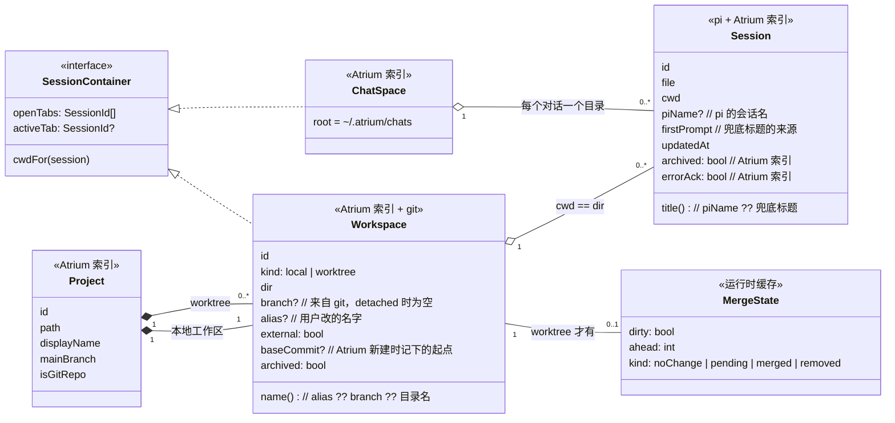
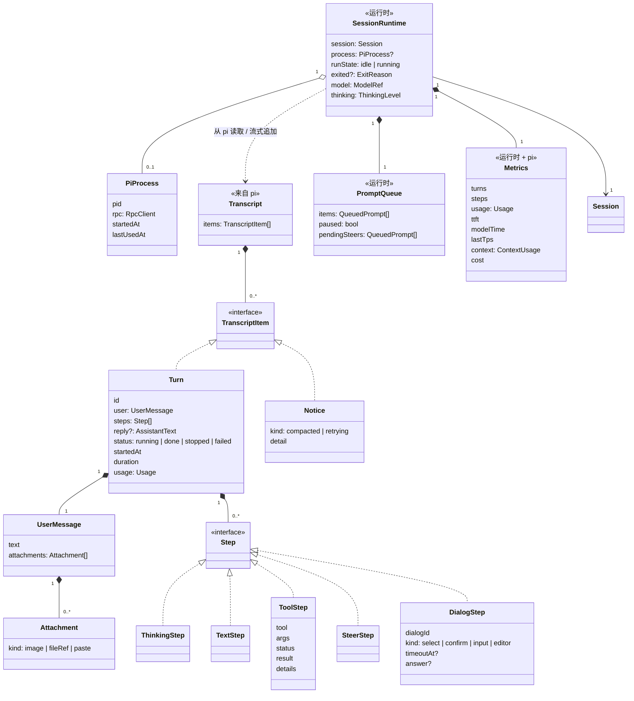
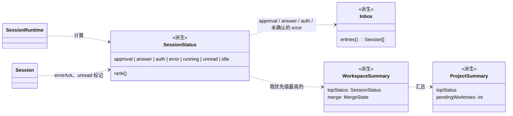
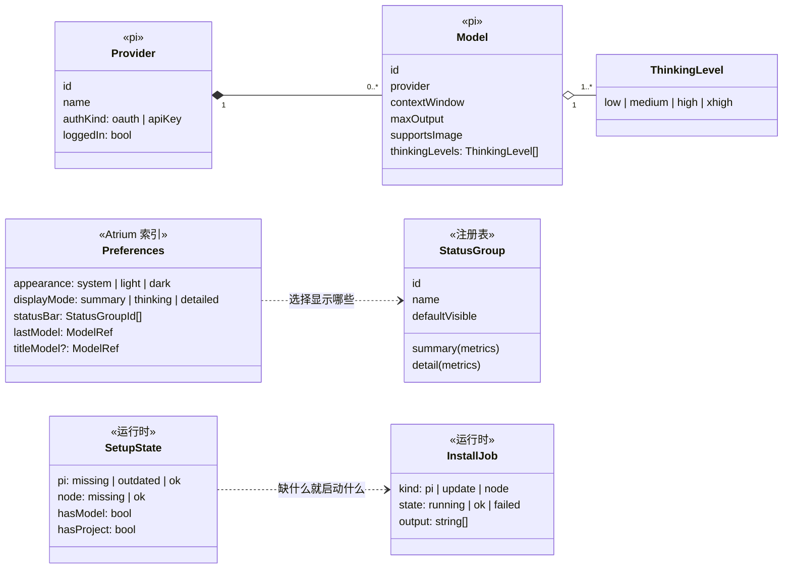
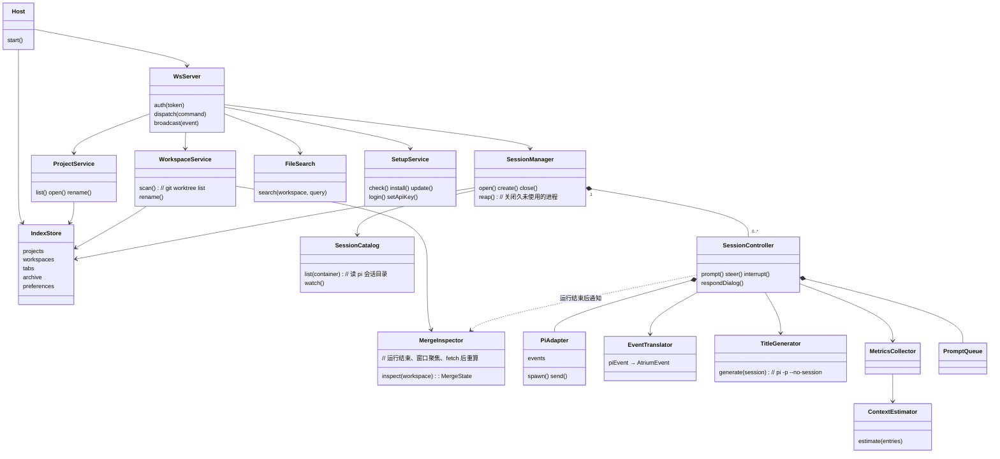
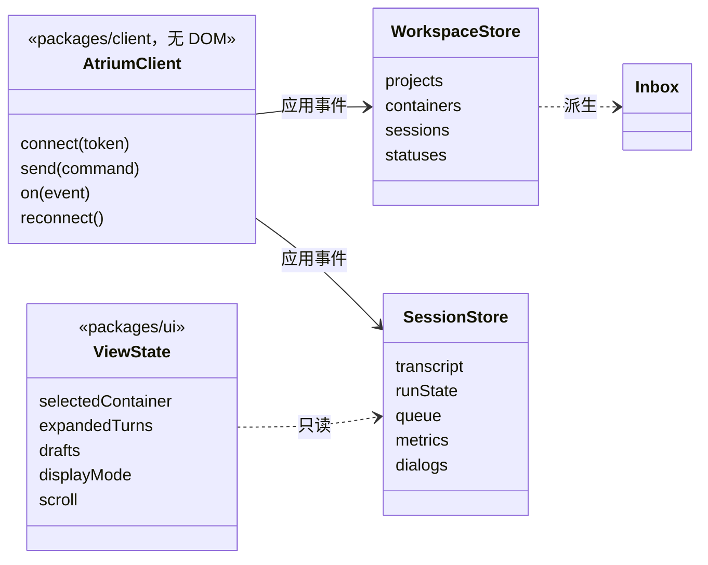

# 领域模型

> 状态：草案，覆盖 MVP 1（[SPEC-0001](../specs/0001-mvp1-single-session-chat.md)）涉及的全部概念。实施时以代码为准，字段随实现补全；概念或关系变了先改本文。

本文回答两个问题：Atrium 里有哪些"东西"，它们之间是什么关系；每样东西的数据归谁保存、由谁计算。

## 数据归属

先分清三类数据，后面每个类都标明属于哪一类：

| 归属 | 存在哪里 | 谁写 | 例子 |
|---|---|---|---|
| **pi** | `~/.pi/agent/sessions/` 下的会话文件、`~/.pi/agent/auth.json` | pi | 对话内容、会话名、模型凭据 |
| **Atrium 索引** | `~/.atrium/`（宿主持有） | 宿主 | 项目列表、工作区别名、打开着的标签页、归档标记 |
| **运行时** | 宿主内存 | 宿主 | pi 进程、排队、运行状态、合并状态缓存、指标 |
| **视图** | UI 内存 / 本地存储 | UI | 展开的过程、滚动位置、草稿、外观偏好 |

原则：对话内容只在 pi 里有一份（[ADR-0006](../adr/0006-organize-sessions-by-workspace.md)）；凡是能从 pi 或 git 推出来的（会话标题、工作区名、合并状态），Atrium 不存，只缓存。

## 1. 项目、工作区、会话

- **Project**：一个代码目录。显示名默认取目录名，同名时自动加序号，可以改名。
- **Workspace**：与目录一一对应。每个项目有且只有一个本地工作区（项目目录本身），其余每个 worktree 一个。名字默认是分支名，`alias` 只存在 Atrium 里。
- **ChatSpace**：不绑定项目的"对话"的容器，全局只有一个。每个对话在 `~/.atrium/chats/<id>/` 下有自己的目录。
- **SessionContainer**：Workspace 和 ChatSpace 的共同接口。标签页、"历史"、`+` 新建都只依赖这个接口，所以对话区不区分自己是在工作区里还是在对话里。
- **Session**：一个 pi 会话文件。归属由 `cwd` 决定：`cwd` 等于某个工作区目录就属于它，在 `~/.atrium/chats/` 下就属于 ChatSpace。终端里开的 pi 会话同样被识别。
- **MergeState**：worktree 的合并状态，由宿主用 git 计算并缓存，不持久化（判断规则见 SPEC-0001"worktree 合并状态"）。

## 2. 会话内部：运行、轮、步骤、排队

- **SessionRuntime**：会话"活着"时的宿主侧对象。一个会话最多一个 pi 进程；空闲超过 10 分钟又不在显示时，关掉进程但保留 SessionRuntime 的轻量状态，下次用到再以 `--session` 启动。
- **Turn**：一轮 = 一次用户提问 + 之间所有的步骤 + 最后一段文字。最后一段文字作为回复，前面的文字作为 `TextStep` 收进过程。
- **Step** 的几种具体形态决定了过程里的一行怎么画：
  - `ToolStep` 按工具名再细分展示：`bash`、`read`、`edit`、`write`、其他（含 MCP）；连续的只读工具在界面上合并成一行"探索"，这是展示层的分组，不是新的类。
  - `DialogStep` 对应 extension 弹出的对话框，回答后保留为"问题 → 回答"。
  - `SteerStep` 是插话送达的位置。
- **PromptQueue**：宿主自己的排队，不用 pi 的 `follow_up`。`pendingSteers` 是已经调用 `steer`、还没送达的插话。只在内存里。
- **Metrics**：状态栏的数据源。`usage` 和 `context.total` 来自 pi 的 `get_session_stats`；`ttft`、`modelTime`、`lastTps` 由宿主计时；`context` 的分段由 ContextEstimator 估算。
- **每轮改动汇总**、**本会话改动**不单独建类：由 `Turn.steps` 里的 `edit` / `write` 工具结果统计得出。

## 3. 状态的派生

会话状态、收件箱、项目行上的汇总都是**派生值**，不存储：

- **SessionStatus** 的优先级（从高到低）：待审批（MVP 2）、待回答、待授权、出错、运行中、已完成未读（以后）、空闲。来源：
  - 运行中：`runState == running`；
  - 待回答：有未作答的 `DialogStep`；
  - 待授权：pi 报告认证失败；
  - 出错：`exited` 非正常或运行失败；打开过后 `errorAck = true`，从收件箱移出，直到下次运行开始。
- **Inbox**：所有容器里状态属于"等你处理"或未确认出错的会话，按状态优先级、再按时间排序。
- **会话标题**：`piName ?? 第一条用户消息的第一行`。第一轮结束后由 TitleGenerator 生成并写回 `piName`。
- **工作区名**：`alias ?? branch ?? 目录名`。

## 4. 模型、设置与首次启动

- **Provider / Model / ThinkingLevel** 都来自 pi（`get_available_models`、`get_available_thinking_levels`）。模型按钮只是它们的视图。
- **StatusGroup** 是一个注册表：每组定义自己的摘要和详情，`Preferences.statusBar` 决定显示哪些。加指标只需注册一组。
- **SetupState** 决定首次启动显示哪一步；**InstallJob** 是一次安装或更新，输出实时推给 UI。

## 5. 宿主的组件

上面是"数据"，下面是"谁来处理这些数据"。箭头表示依赖。

- **SessionController** 是一个会话的"总管"：持有 PiAdapter（进程）、PromptQueue（排队）和这次运行的计时，把 pi 的事件经 EventTranslator 翻成 Atrium 协议再广播。一个会话最多一个。
- **PiAdapter** 封装 pi 的 RPC（倾向直接用 pi 自带的 `RpcClient`），是唯一知道 pi 协议细节的地方。
- **SessionCatalog** 只读：扫描 `~/.pi/agent/sessions/`，按 `cwd` 把会话分到容器。
- **MergeInspector** 只读 git，结果按"分支提交 + 主干提交"缓存，同时最多跑 4 个 git 命令。
- **SetupService** 包含安装（运行官方脚本、`pi update --self`、`brew install node`）和登录（调用 pi 的 OAuth 实现）。

## 6. 客户端与界面

- **AtriumClient** 和两个 Store 在 `packages/client`，不依赖 DOM，以后的原生 App 可以直接复用。
- **SessionStore** 只为打开着的会话保存完整对话；其余会话只有状态和标题。流式输出的"平滑揭示"属于界面，不改变 Store 里的完整文本。
- **ViewState** 是纯界面状态：展开了哪些过程、每个会话的草稿、显示模式、滚动位置。

## 7. 协议与类的对应

| 命令 | 落到 |
|---|---|
| `list_projects` / `open_project` / `rename_project` | ProjectService |
| `list_workspaces` / `rename_workspace` | WorkspaceService |
| `list_sessions` / `list_chats` / `create_session` / `create_chat` / `open_session` / `close_session` / `rename_session` | SessionManager |
| `prompt` / `steer` / `update_queued` / `remove_queued` / `steer_queued` / `interrupt` / `respond_dialog` / `set_model` / `set_thinking_level` | SessionController |
| `list_models` / `list_commands` | PiAdapter（经 SessionController） |
| `search_files` | FileSearch |
| `check_setup` / `install_*` / `update_pi` / `login` / `set_api_key` | SetupService |

| 事件 | 来源 |
|---|---|
| `session_snapshot` / `message_*` / `tool_*` / `run_*` / `dialog_*` / `notice` / `session_exited` | SessionController（经 EventTranslator） |
| `queue_updated` | PromptQueue |
| `metrics_updated` | MetricsCollector |
| `session_renamed` | TitleGenerator 或重命名命令 |
| `workspace_updated` | WorkspaceService / MergeInspector |
| `install_output` / `install_finished` | SetupService |

## 待定

- [ ] **对话的目录**：每个对话一个目录，是否也该算一个"工作区"（这样 ChatSpace 只是一组隐藏的工作区）。目前用 SessionContainer 接口统一，两种实现都能兼容，实施时再定。
- [ ] **会话 id**：用 pi 的会话 id 还是会话文件路径作为 Atrium 侧的主键。文件可能被移动或重命名时，以 pi 的 id 更稳。
- [ ] **SessionRuntime 的生命周期**：进程关闭后是否保留 Metrics 等内存状态，还是下次重新从 pi 恢复。
- [ ] **跨窗口 / 多客户端**：多个 UI 连同一个宿主时，ViewState 各自独立，打开着的标签页是否同步。
