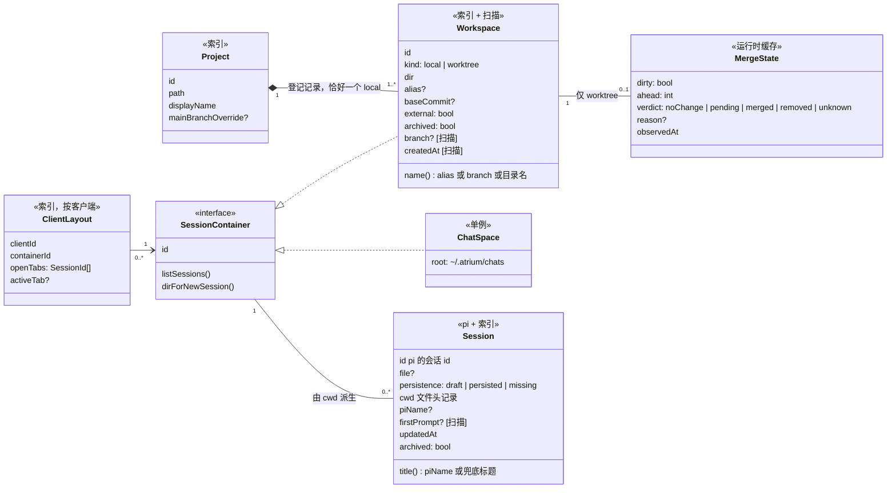
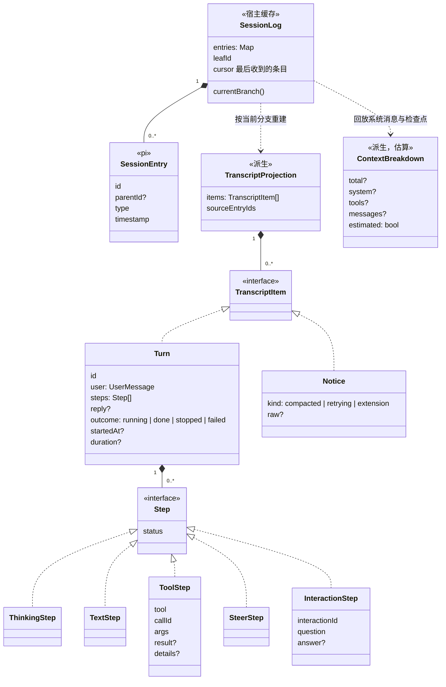
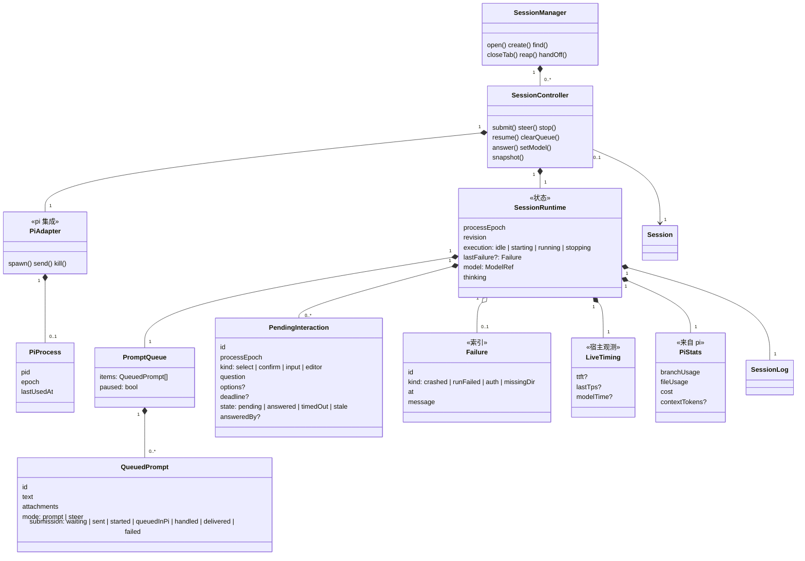
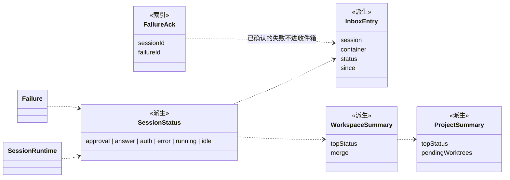
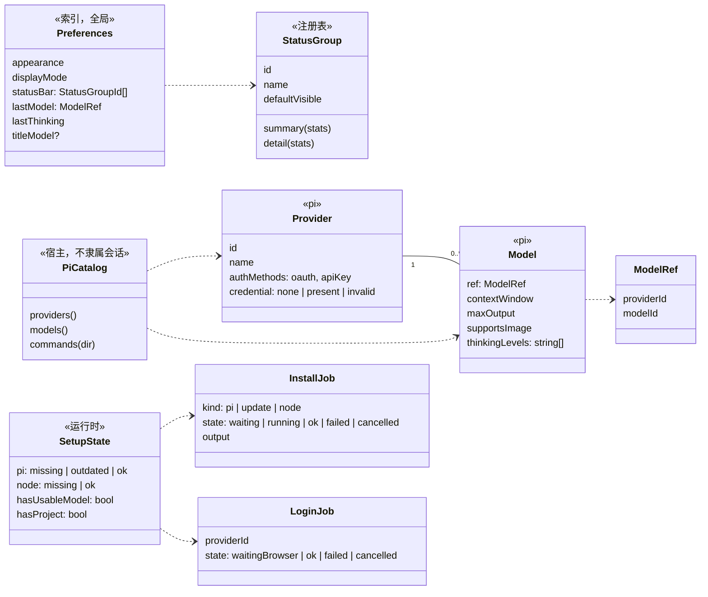
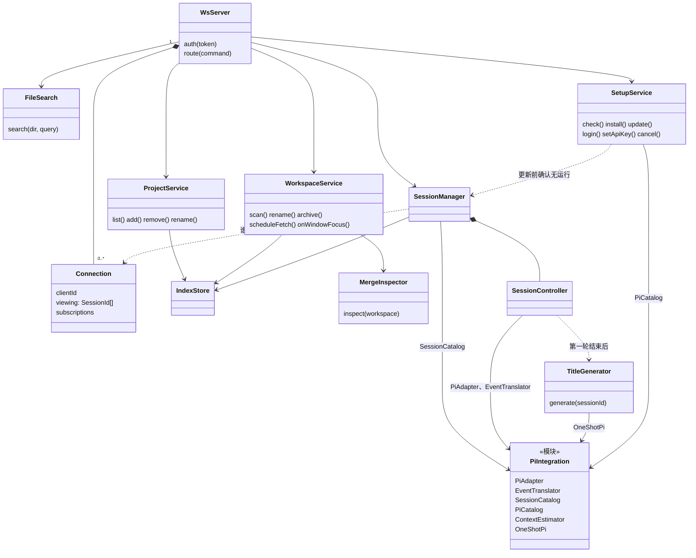
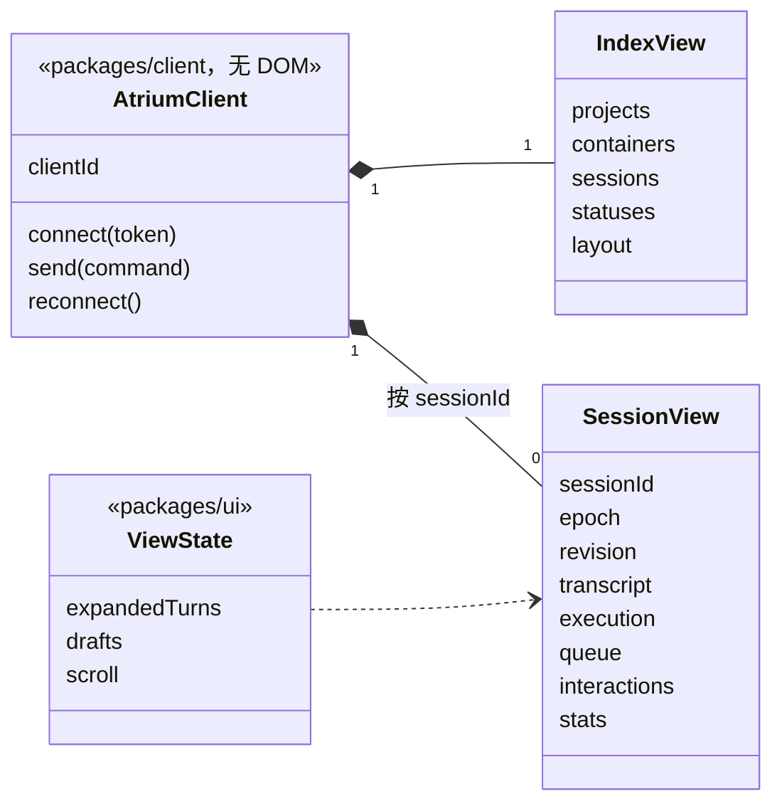

# 领域模型

> 状态：草案（第 2 版），覆盖 MVP 1（[SPEC-0001](../specs/0001-mvp1-single-session-chat.md)）涉及的全部概念。第 1 版经 Grok 4.7 与 GPT-6-Astra 两轮评审后重写，关于 pi 的假设对照 pi 1.0.1（提交 `4c6fb7c`）的源码核实过。实施时以代码为准，字段随实现补全；概念或关系变了先改本文。

本文回答三个问题：Atrium 里有哪些"东西"、它们之间是什么关系；每样东西的数据以谁为准；多个会话、多个客户端、进程崩溃时状态怎样保持一致。

## 数据归属

| 归属 | 存在哪里 | 谁写 | 例子 |
|---|---|---|---|
| **pi** | `~/.pi/agent/sessions/` 下的会话文件、`~/.pi/agent/auth.json` | pi | 会话条目（对话、工具结果、系统消息、压缩检查点）、会话名、凭据 |
| **Atrium 索引** | `~/.atrium/`（宿主持有） | 宿主 | 项目登记、工作区别名与起点提交、归档、失败记录与确认、每个客户端的布局、偏好 |
| **运行时** | 宿主内存 | 宿主 | pi 进程、排队、待交互请求、运行状态、当场计时、合并状态缓存 |
| **扫描结果** | 宿主内存（可随时重算） | 宿主 | 分支名、是否 git 仓库、worktree 创建时间、会话文件位置、第一条用户消息 |
| **视图** | 各客户端自己 | UI | 展开的过程、滚动位置、草稿 |

原则：

- 对话内容只在 pi 里有一份（[ADR-0006](../adr/0006-organize-sessions-by-workspace.md)）。能从 pi 或 git 推出来的，Atrium 只缓存，不写进索引。
- 每个字段只有一个可写来源。显示模式、状态栏分组是全局偏好；标签页、当前容器是某个客户端的布局；两者不混放。
- 只在宿主内存里的东西（排队、待交互请求、当场计时）宿主重启后丢失，界面显示"未知"或"—"，不假装恢复。

## 1. 项目、工作区、会话

- **Project** 拥有的是登记记录：从侧栏移除项目只删 `~/.atrium/` 里的记录，不碰磁盘。路径规范化后唯一，已经是某个项目的 worktree 的目录不能再登记成项目。主干分支只存用户的覆盖值，显示时取 `mainBranchOverride ?? origin/HEAD`。
- **Workspace** 与目录一一对应。每个项目恰好一个 `local`（`dir == Project.path`），其余是 `worktree`。分支、创建时间是扫描结果，不进索引。
- **ChatSpace** 是不绑定项目的"对话"的容器，全局一个。每个对话有自己的目录 `~/.atrium/chats/<dirId>/`，目录 id 与会话 id 无关。
- **SessionContainer** 只表达"会话放在哪、怎么列、新会话在哪个目录建"。工作区对所有会话给同一个目录，ChatSpace 每次新建一个目录。标签页不在接口上，在 **ClientLayout**。
- **Session** 是逻辑会话，以 pi 的会话 id 为主键，文件路径只是可更新的定位：
  - `draft`：pi 已分配 id，但还没有用户消息，文件尚未写出；只能由宿主记住，扫描找不到。
  - `persisted`：文件存在。
  - `missing`：索引里有，扫描不到文件（被删除或移走）。
  - 归属由文件头里的 `cwd` 决定。pi 恢复会话时用的就是这个 `cwd`；工作区目录被移走或删除时，恢复报"目录不存在"，不悄悄换目录。
  - 扫描到两个文件带同一个 id 时报告冲突，不自动合并。
- **MergeState** 由 MergeInspector 计算。`unknown` 带原因：git 低于 2.38、主干引用缺失、查询失败、外部 worktree 起点无法判断。合并判定按"分支提交 + 主干提交"缓存；`dirty` 和目录是否存在每次单独刷新。界面映射：`dirty` 优先显示"未提交"，否则 `ahead > 0` 显示 `↑N`，再看 `verdict`。

## 2. 会话历史：条目、分支与对话记录

pi 的会话文件是一棵树：每个条目有 `id` 和 `parentId`，当前所在位置由 `leafId` 指出，分叉会产生新的分支。

- **SessionLog** 是宿主对 pi 条目的缓存，用 `get_entries(since)` 增量获取。它同时记两样东西：条目游标，以及当前分支叶子。`get_entries` 返回空时 `leafId` 仍可能变化，所以两者分开维护。
- **不用 `get_messages` 恢复历史**：它返回的是送给模型的上下文，压缩、上下文编辑之后旧消息可能已被摘要替换，会丢掉完整的对话、工具步骤和改动。
- **TranscriptProjection** 是给对话区看的投影：沿当前分支把条目组织成 Atrium 的"轮"。注意 pi 的 turn 是"一次助手响应及其工具执行"，比 Atrium 的一轮小；Atrium 的一轮 = 一条用户消息到下一条用户消息之间的全部内容。MVP 1 不展示会话树，但底层按树建模，以后加会话树、分叉不用重来。
- **ContextBreakdown** 给状态栏用，是估算值：总量来自 `get_session_stats().contextUsage`（可能为空或是估算）；系统提示词和工具定义沿当前分支回放系统消息与压缩检查点得出；没有系统消息的旧会话只显示总量。MVP 2 的上下文检查器要的是"每次实际发出的请求"，另由 extension 捕获，不从这里升级。
- **Notice** 里 `extension` 类型保留无法识别的 extension 通知原文，MVP 1 只记录不显示，MVP 2 的"带标记的通知"从这里接入。
- **InteractionStep** 只是对话记录里"问题 → 回答"的展示，活着的请求见下一节的 PendingInteraction。pi 不把对话框写进会话文件，所以这一步只在宿主存活期间存在。
- **ToolStep** 各自带状态，同一批里的工具调用可以并行，不假设前一个结束后一个才开始。
- **改动汇总**不建类，语义是"已观测到的工具修改"：`edit` 有 diff，显示增删行；`write` 显示写入内容，增删行未知时不显示数字；通过 bash 等其他方式的改动统计不到。多次编辑同一文件是累计编辑量，不是净改动。

## 3. 会话运行：控制器、运行状态、排队、待交互

**职责**

- **SessionController** 管行为，是一个会话唯一的协调者；**SessionRuntime** 是它唯一持有的状态，不是第二个管理者。排队、待交互、条目缓存、指标都在 Runtime 里；进程句柄在 PiAdapter 里。一个会话最多一个 Controller。
- **SessionManager** 负责 Controller 的创建、查找、回收，以及几种"离开"动作。

**几种"离开"分开命名**

| 动作 | 做什么 | 不做什么 |
|---|---|---|
| 关闭标签 `closeTab` | 只改这个客户端的 ClientLayout | 不停运行、不动排队和进程 |
| 停止 `stop` | 宿主先暂停出队，再对 pi `clear_queue` → `abort`；排队保留并暂停 | 不关进程 |
| 回收 `reap` | 关掉 pi 进程 | 正在运行、有人在看、有待交互请求的不回收；排队、失败记录、当场计时保留 |
| 丢弃 Controller | 进程已回收、排队为空、没有待交互、没人在看时整个丢掉 | — |
| 重新打开 `open` | 以 `--session` 启动新进程（`processEpoch + 1`），重建 SessionLog | 不自动重放结果未知的上一条输入 |
| 交给终端 `handOff` | 停止接受这个会话的写命令，回收进程，给出 `pi --session <文件>`；回来时重新加载 | Atrium 与终端不同时写同一个会话 |

**排队与提交**

- 发出一条输入后，pi 的回应有三种：`started`（启动了运行）、`queued`（运行中被 pi 排进去）、`handled`（被 extension 命令或输入处理器消费，没有运行）。`handled` 视为这条输入已完成，可以出队下一条，不等 `agent_settled`。
- `agent_settled` 只表示"不会再自动继续"，本轮是成功、失败还是被停止，看实际事件单独判断。
- 停止和 `agent_settled` 触发的出队由 Controller 串行处理，避免停止的同时又发出下一条。
- pi 的 `clear_queue` 只清 pi 自己的队列，宿主的排队由 `clearQueue` / `resume` 单独操作。

**待交互请求**

- extension 的对话框（`extension_ui_request`）可能出现在一次运行之外，所以由 Runtime 持有，不挂在某一轮上；对话记录里的 InteractionStep 只是展示。
- 有待交互请求的会话不回收。进程退出时，旧请求一律标记为 `stale`。多个客户端同时回答，只接受第一次有效提交，其余收到"已被回答"。
- MVP 1 只保证宿主存活期间保留"问题 → 回答"；要跨重启保留，需要写入 pi 的条目，以后再说。

**进程崩溃**

统一处理：`execution` 回到 `idle`，排队暂停（已调用 `steer` 但未确认送达的插话退回排队），待交互请求作废，写入一条 Failure，发 `session_exited`。

**指标的范围**

- **PiStats** 来自 `get_session_stats`，统计的是整个会话文件（含其他分支和压缩消耗），与当前分支上各轮相加不等；上下文用量可能为空或是估算。界面上区分"本会话累计"和"当前分支"，未知值显示"—"。
- **LiveTiming** 是宿主当场测的（TTFT、输出速度、模型用时），宿主存活期间随 Runtime 保留，重启后显示"—"。从历史时间戳推算的每轮用时是近似值。
- 状态栏的"步"只数工具调用。

## 4. 状态的派生

- **SessionStatus** 按优先级取第一个成立的：待审批（MVP 2）、待回答（有 `pending` 的 PendingInteraction）、待授权（最近失败类型为 `auth`）、出错（最近失败为 `crashed` / `runFailed` / `missingDir`，直到下一次运行开始）、运行中、空闲。"已完成未读"以后再做，届时在索引里记"看到的是哪一次运行"。
- **出错与确认分开**：状态保持 `error`，所以标签和工作区行上的红色图标一直在；收件箱只收"`error` 且没有对应 FailureAck"的会话。某个客户端打开该会话时写入 FailureAck，指向具体那一次失败，下一次失败不会被旧的确认吞掉。
- **InboxEntry** 带上所在容器，界面才能显示"项目 · 工作区"或"对话"。
- **会话标题** `piName ?? 第一条用户消息的第一行`；**工作区名** `alias ?? branch ?? 目录名`。

## 5. 模型、设置与首次启动

- **ModelRef** 用"服务商 + 模型 id"联合标识。推理档位是字符串列表，来自 pi 对该模型的能力查询（pi 的档位包括 off / minimal / low / medium / high / xhigh / max，具体有哪些由模型决定），推理强度框按实际档位数画格子。
- **Provider** 区分"支持哪些登录方式"和"当前凭据状态"，有凭据不等于登录有效。
- **PiCatalog** 不依赖任何会话进程：空工作区、首次启动、模型按钮都要用。需要时短时启动 pi 查询，结果缓存。`/` 命令和工作目录有关（项目里的 skill），按目录查询。
- **LoginJob**、**InstallJob** 是可查询、可取消的任务。更新 pi 时 InstallJob 先处于 `waiting`，等 SessionManager 报告没有会话在运行再开始。

## 6. 宿主的组件

- **PiIntegration** 是一个模块，不是一个类：PiAdapter（RPC 进程，倾向用 pi 自带的 `RpcClient`）、EventTranslator（纯函数，pi 事件 → Atrium 事件）、SessionCatalog（只读扫描会话目录，发现已写出的会话和历史工作目录）、PiCatalog、ContextEstimator、OneShotPi（`pi --mode json -p --no-session` 一次性调用）。pi 的格式和协议细节只出现在这个模块里，对外只给 Atrium 类型。
- **Connection** 记录每个客户端在看哪些会话，供回收判断，以及"打开即确认失败"。
- **TitleGenerator** 走 OneShotPi，单独起一次性进程，不借正在运行的会话。
- **WorkspaceService** 负责调度后台 `git fetch` 和窗口聚焦后的重算；**MergeInspector** 只做判定。`git merge-tree --write-tree` 不改工作区和 index，但会创建 git 对象，所以它"不改工作区"，不是"只读"。
- **FileSearch** 在 git 仓库里用 `git ls-files`；非 git 目录按忽略规则遍历，限制深度和数量。
- 指标的计时和汇总是 SessionController 内部的事，不单独成服务。

## 7. 客户端与一致性

**命令与事件的身份**

- 每条会话命令带 `sessionId` 和客户端生成的 `requestId`，宿主据此路由和去重；连接上没有隐式的"当前会话"。
- 每条会话事件带 `sessionId`、`epoch`（进程代次）、`revision`（会话内单调递增）；消息和工具事件再带各自的 id。

**快照与重连**

- 快照由 SessionController 从同一份 Runtime 状态生成，带当时的 `epoch + revision`，包含流式中的消息、工具状态、排队、待交互、指标、最近失败。客户端只应用 `revision` 更大的后续事件。
- 连接建立或重连时，先推 `index_snapshot`（项目、工作区、各会话的派生状态、该客户端的布局），再对正在运行的会话和该客户端打开着的会话各推一份 `session_snapshot`。
- 断线不重发结果未知的写命令；客户端靠快照判断它是否已生效。
- 不需要持久化的事件总线：断线后重新取快照即可。

**多客户端**

会话、排队、运行状态、待交互由宿主统一，广播给所有连接；布局按 `clientId` 分开存，一个客户端关标签不影响别人；草稿、滚动、展开状态只在客户端本地。

## 8. 协议与类的对应

| 命令 | 落到 |
|---|---|
| `list_projects` / `add_project` / `remove_project` / `rename_project` | ProjectService |
| `list_workspaces` / `rename_workspace` / `window_focused` | WorkspaceService |
| `list_sessions` / `list_chats` / `create_session` / `create_chat` / `open_session` / `close_tab` / `archive_session` / `rename_session` / `hand_off` | SessionManager |
| `prompt` / `steer` / `stop` / `resume_queue` / `clear_queue` / `update_queued` / `remove_queued` / `steer_queued` / `answer_interaction` / `set_model` / `set_thinking_level` | SessionController |
| `list_models` / `list_commands(dir)` | PiCatalog |
| `search_files(dir, query)` | FileSearch |
| `check_setup` / `install_*` / `update_pi` / `cancel_install` / `login` / `cancel_login` / `set_api_key` | SetupService |

| 事件 | 来源 |
|---|---|
| `index_snapshot` / `workspace_updated` / `session_listed` | WorkspaceService、SessionManager |
| `session_snapshot` / `message_*` / `tool_*` / `run_started` / `run_settled` / `interaction_*` / `notice` / `session_exited` | SessionController（经 EventTranslator） |
| `session_bound` | SessionManager：草稿会话拿到文件后通知 |
| `queue_updated` / `metrics_updated` | SessionController |
| `session_renamed` | TitleGenerator 或重命名命令 |
| `install_*` / `login_*` | SetupService |

## 已决定

1. **对话不算工作区**：保留 ChatSpace，通过 SessionContainer 与工作区统一选择、列表和新建入口；目录分配策略不同。
2. **会话主键用 pi 的会话 id**，文件路径是可更新的定位；草稿会话也有 id；同 id 多文件报冲突。
3. **进程回收后保留轻量 Runtime**：排队、暂停状态、失败记录、当场计时保留；历史和累计用量下次从 pi 重建。宿主重启后当场计时显示"—"。
4. **标签页不跨客户端同步**：布局按 `clientId + containerId` 存在索引里。

## 待定

- [ ] **失败重试**："重试"是重新提交上一条输入，还是调用 pi 的某个命令，实施时确认后再补类。
- [ ] **草稿会话的保留**：宿主重启后，没发过消息的空标签是否恢复。
- [ ] **孤儿目录**：新建对话后一条消息都没发就关掉，`~/.atrium/chats/` 下的空目录何时清理。
- [ ] **外部改动**：发现会话文件被终端 pi 改过时，如何提示重新加载。
