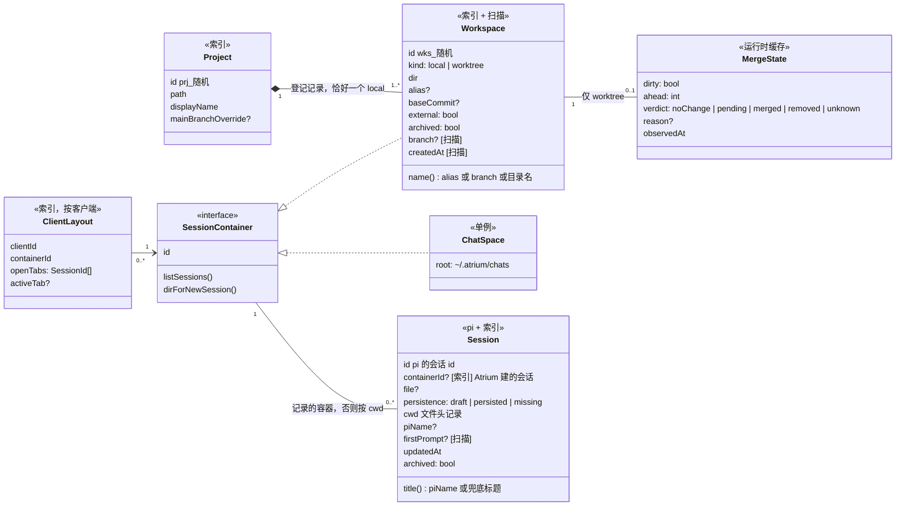
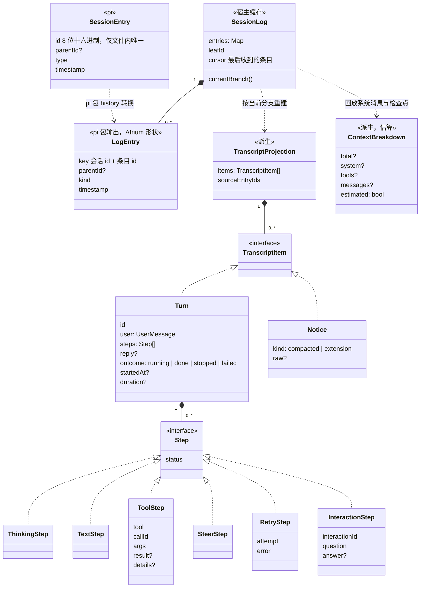
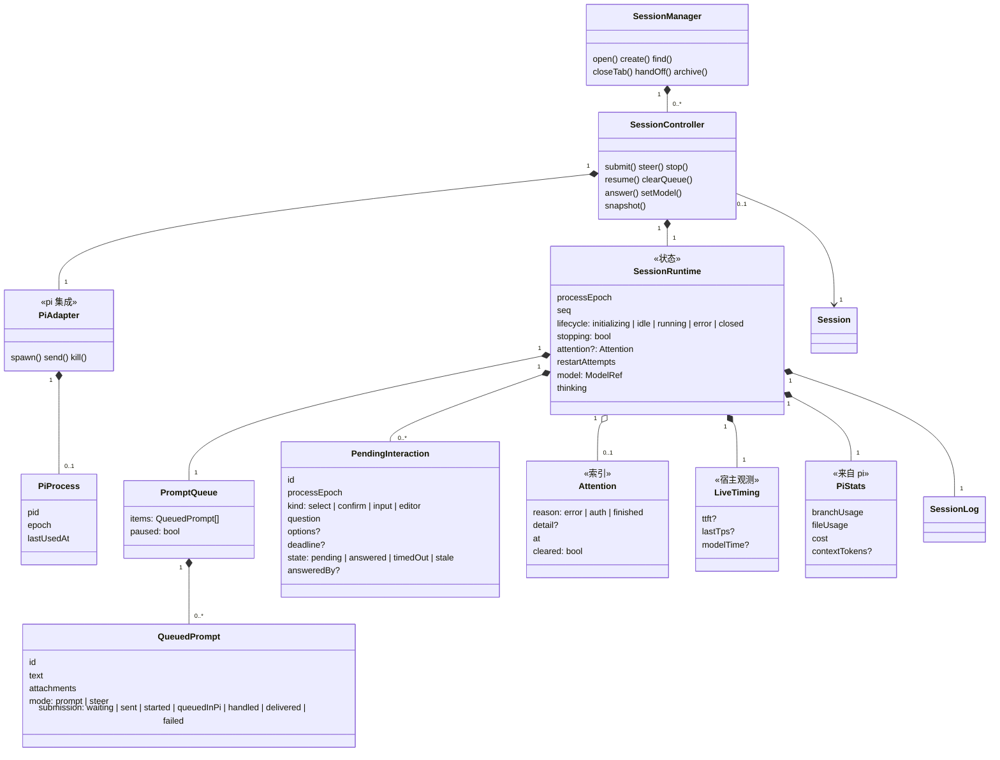
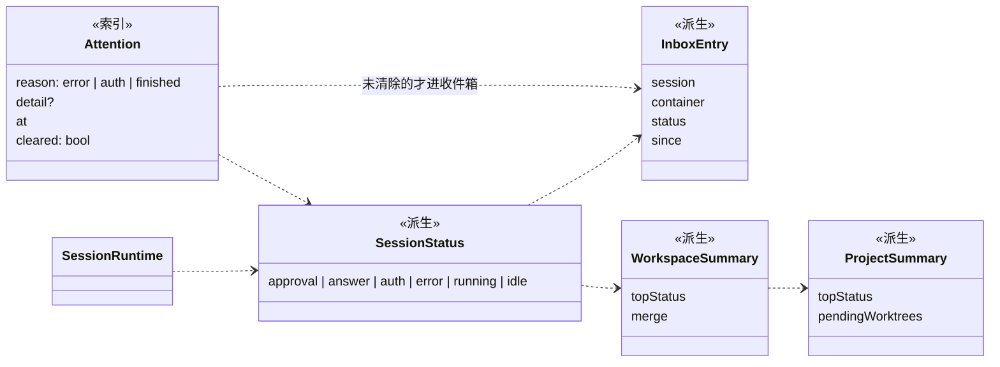
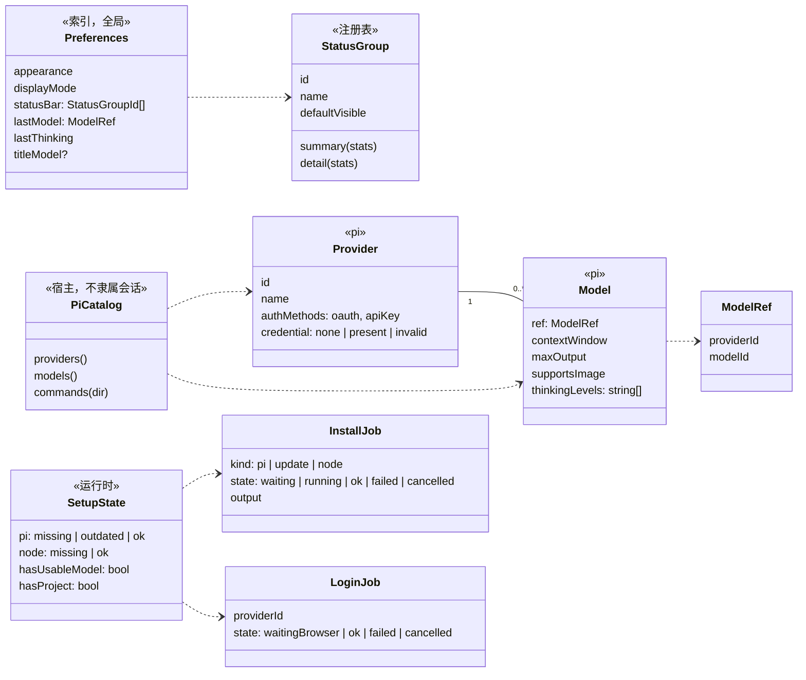
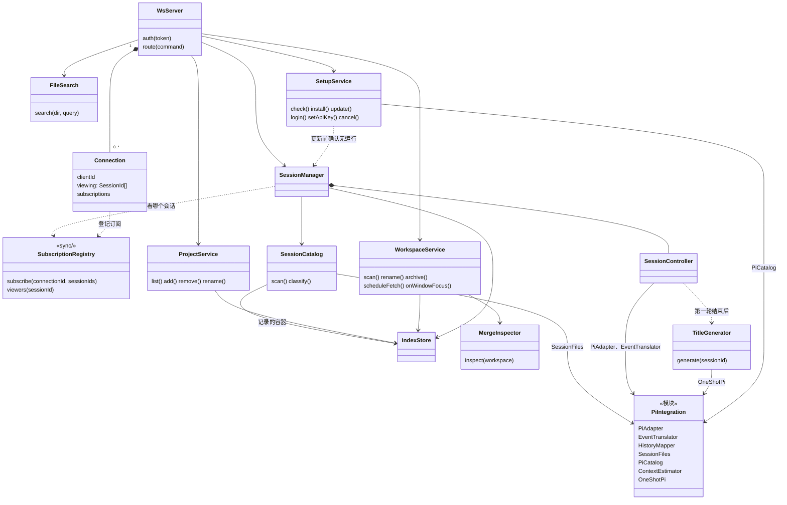
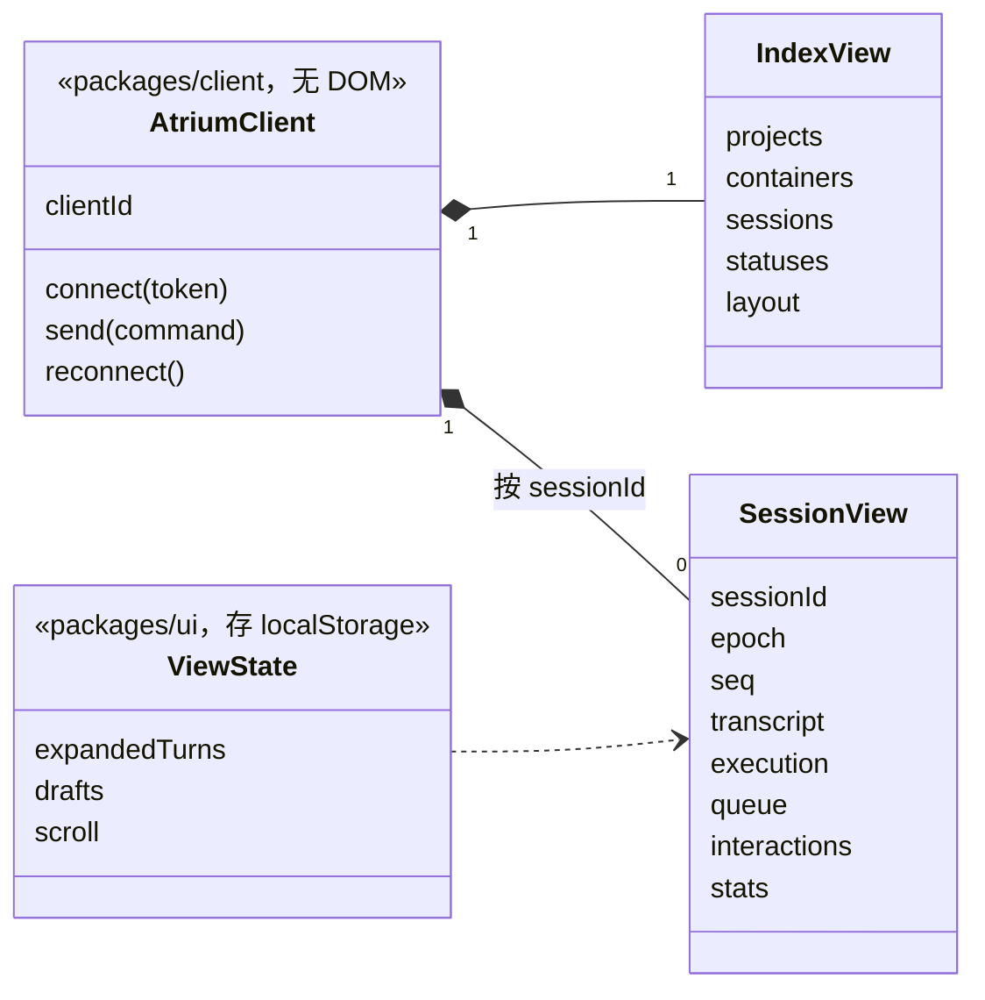

# 领域模型

> 状态：草案（第 3 版），覆盖 MVP 1（[SPEC-0001](../specs/0001-mvp1-single-session-chat.md)）涉及的全部概念。第 1 版经 Grok 4.7 与 GPT-6-Astra 两轮评审后重写；第 3 版又对照了 Paseo（`42806cd`）的实现和 pi 1.0.1（`4c6fb7c`）的源码，借鉴 Paseo 的 id、关注状态和同步设计。实施时以代码为准，字段随实现补全；概念或关系变了先改本文。

本文回答三个问题：Atrium 里有哪些"东西"、它们之间是什么关系；每样东西的数据以谁为准；多个会话、多个客户端、进程崩溃时状态怎样保持一致。

## 数据归属

| 归属 | 存在哪里 | 谁写 | 例子 |
|---|---|---|---|
| **pi** | `~/.pi/agent/sessions/` 下的会话文件、`~/.pi/agent/auth.json` | pi | 会话条目（对话、工具结果、系统消息、压缩检查点）、会话名、凭据 |
| **Atrium 索引** | `~/.atrium/`（宿主持有） | 宿主 | 项目和工作区登记、Atrium 建的会话属于哪个容器、工作区别名与起点提交、归档、关注状态、每个客户端的布局、偏好 |
| **运行时** | 宿主内存 | 宿主 | pi 进程、排队、待交互请求、运行状态、当场计时、合并状态缓存 |
| **扫描结果** | 宿主内存（可随时重算） | 宿主 | 分支名、是否 git 仓库、worktree 创建时间、会话文件位置、第一条用户消息 |
| **视图** | 各客户端自己 | UI | 展开的过程、滚动位置、草稿 |

原则：

- 对话内容只在 pi 里有一份（[ADR-0006](../adr/0006-organize-sessions-by-workspace.md)）。能从 pi 或 git 推出来的，Atrium 只缓存，不写进索引。
- 每个字段只有一个可写来源。显示模式、状态栏分组是全局偏好；标签页、当前容器是某个客户端的布局；两者不混放。
- 只在宿主内存里的东西（排队、待交互请求、当场计时）宿主重启后丢失，界面显示"未知"或"—"，不假装恢复。

## 1. 项目、工作区、会话

- **Project**、**Workspace** 的 id 是随机生成的不透明 id（`prj_…`、`wks_…`，参照 Paseo），路径只是一个可变字段，不当 id 用。
- **Project** 拥有的是登记记录：从侧栏移除项目只删 `~/.atrium/` 里的记录，不碰磁盘。路径规范化后唯一，已经是某个项目的 worktree 的目录不能再登记成项目。主干分支只存用户的覆盖值，显示时取 `mainBranchOverride ?? origin/HEAD`。
- **Workspace** 与目录一一对应。每个项目恰好一个 `local`（`dir == Project.path`），其余是 `worktree`。分支、创建时间是扫描结果，不进索引。
- **ChatSpace** 是不绑定项目的"对话"的容器，全局一个。每个对话有自己的目录 `~/.atrium/chats/<dirId>/`，目录 id 与会话 id 无关。
- **SessionContainer** 只表达"会话放在哪、怎么列、新会话在哪个目录建"。工作区对所有会话给同一个目录，ChatSpace 每次新建一个目录。标签页不在接口上，在 **ClientLayout**。
- **Session** 是逻辑会话，以 pi 的会话 id 为主键，文件路径只是可更新的定位：
  - `draft`：pi 已分配 id，但还没有用户消息，文件尚未写出；只能由宿主记住，扫描找不到。
  - `persisted`：文件存在。
  - `missing`：索引里有，扫描不到文件（被删除或移走）。
  - **归属**：Atrium 自己建的会话，创建时把所属容器记进索引（`containerId`），以后以它为准（参照 Paseo：创建时写定，不再推断）。终端里 pi 开的、Atrium 没见过的会话，才按文件头里的 `cwd` 归到对应目录的容器。这样既保留"终端会话自动归位"，以后"把对话移到项目"也只需改记录。
  - pi 恢复会话时用的是文件头里的 `cwd`；工作区目录被移走或删除时，恢复报"目录不存在"，不悄悄换目录。
  - 扫描到两个文件带同一个 id 时报告冲突，不自动合并。
- **MergeState** 由 MergeInspector 计算。`unknown` 带原因：git 低于 2.38、主干引用缺失、查询失败、外部 worktree 起点无法判断。合并判定按"分支提交 + 主干提交"缓存；`dirty` 和目录是否存在每次单独刷新。界面映射：`dirty` 优先显示"未提交"，否则 `ahead > 0` 显示 `↑N`，再看 `verdict`。

## 2. 会话历史：条目、分支与对话记录

pi 的会话文件是一棵树：每个条目有 `id` 和 `parentId`，当前所在位置由 `leafId` 指出，分叉会产生新的分支。

- **LogEntry** 是 pi 包把 pi 条目转换后的形状（`packages/pi/src/history/`），保留 `id / parentId` 的树结构，宿主之后只处理它，不碰 pi 的原始格式；它只在宿主内部用，不进协议。系统消息（提示词分段、工具增减）和压缩检查点也转成对应的 LogEntry，供 ContextEstimator 回放。
- **SessionLog** 是宿主对日志条目的缓存，用 `get_entries(since)` 增量获取。它同时记两样东西：条目游标，以及当前分支叶子。`get_entries` 返回空时 `leafId` 仍可能变化，所以两者分开维护。
  - 条目 id 只在一个文件内唯一（克隆出的会话沿用原 id），跨会话一律用"会话 id + 条目 id"作键。
  - pi 不保存叶子，加载时取文件最后一条为叶子。
  - 切换模型、压缩、标签等写入的条目**不会发事件**。所以在 `agent_settled`、`compaction_end`、以及宿主自己发出的 `set_model` 等命令之后，主动再取一次 `get_entries(since)`，不只靠实时事件。
- **不用 `get_messages` 恢复历史**：它返回的是送给模型的上下文，压缩、上下文编辑之后旧消息可能已被摘要替换，会丢掉完整的对话、工具步骤和改动。
- **TranscriptProjection** 是给对话区看的投影：沿当前分支把条目组织成 Atrium 的"轮"。注意 pi 的 turn 是"一次助手响应及其工具执行"，比 Atrium 的一轮小；Atrium 的一轮 = 一条用户消息到下一条用户消息之间的全部内容。MVP 1 不展示会话树，但底层按树建模，以后加会话树、分叉不用重来。
- **ContextBreakdown** 给状态栏用，是估算值：总量来自 `get_session_stats().contextUsage`（可能为空或是估算）；系统提示词和工具定义沿当前分支回放系统消息与压缩检查点得出；没有系统消息的旧会话只显示总量。MVP 2 的上下文检查器要的是"每次实际发出的请求"，另由 extension 捕获，不从这里升级。
- **Notice** 里 `extension` 类型保留无法识别的 extension 通知原文，MVP 1 只记录不显示，MVP 2 的"带标记的通知"从这里接入。
- 自动重试发生在一轮中间，用 **RetryStep** 显示"正在重试（第 N / 3 次）"，不拆开这一轮；**Notice** 用来显示压缩和"进程已自动重启"（M1.6）。
- **InteractionStep** 只是对话记录里"问题 → 回答"的展示，活着的请求见下一节的 PendingInteraction。pi 不把对话框写进会话文件，所以这一步只在宿主存活期间存在。
- **ToolStep** 各自带状态，同一批里的工具调用可以并行，不假设前一个结束后一个才开始。
- **改动汇总**不建类，语义是"已观测到的工具修改"：`edit` 有 diff，显示增删行；`write` 显示写入内容（取自调用参数，pi 的结果里没有），增删行未知时不显示数字；通过 bash 等其他方式的改动统计不到。多次编辑同一文件是累计编辑量，不是净改动。
- **重建时要注意的条目**（2026-10-08 按 pi 1.0.2 源码核实）：
  - 切换模型和推理强度、标签、会话名、缓存预热的用量、extension 状态、上下文编辑都在父子链上，也会移动叶子；重建时跳过，不当成轮的边界。系统消息是 `message` 条目，同样不进轮。
  - 失败后被重试的回复：出错的助手消息后面跟着一条 `context_edit`（`replacement` 为空）把它从上下文里去掉，重试的回复挂在这条编辑下面。在它之后加一个 RetryStep（"正在重试"），它已输出的部分（通常没有）照常是步骤，不作为回复。
  - 压缩条目排在它总结的条目之后，链条不断，压缩前的条目照常重建，压缩处显示提示条；`firstKeptEntryId` 可能落在一轮中间。
  - 插话和追加消息在文件里都是普通的用户消息；紧跟在工具结果之后、下一次模型回复之前的算插话（SteerStep），其余开始新的一轮。
  - 工具结果按调用 id 配对，不按位置；一轮结束后仍没有结果的工具调用显示为"未完成"。
  - 可能有多个根（`branch_summary` 的父为空）；叶子用 `get_entries` 返回的 `leafId`，不用最后一条。会话被 fork 或 clone 成新文件时，缓存全部作废。
  - 实时事件不带条目 id。轮在实时时由宿主编号，运行结束后按顺序对应到新的用户消息条目并沿用实时编号，见 SPEC-0001"对话记录"。

## 3. 会话运行：控制器、运行状态、排队、待交互

**职责**

- **SessionController** 管行为，是一个会话唯一的协调者；**SessionRuntime** 是它唯一持有的状态，不是第二个管理者。排队、待交互、条目缓存、指标都在 Runtime 里；进程句柄在 PiAdapter 里。一个会话最多一个 Controller。
- **SessionManager** 负责 Controller 的创建、查找，以及几种"离开"动作。
- **生命周期**沿用 Paseo 的划分：`initializing`（进程启动中）、`idle`、`running`（从提交到 `agent_settled`，含自动重试和压缩）、`error`（进程异常退出或运行失败）、`closed`（有记录、没有进程，比如宿主重启后还没打开过）。
- **MVP 1 不回收空闲进程**（与 Paseo 一致）：会话一旦打开，pi 进程就常驻，直到归档、交给终端、宿主退出或进程崩溃。以后会话多了再加回收。

**几种"离开"分开命名**

| 动作 | 做什么 | 不做什么 |
|---|---|---|
| 关闭标签 `closeTab` | 只改这个客户端的 ClientLayout | 不停运行、不动排队和进程 |
| 停止 `stop` | 宿主先暂停出队，再对 pi `clear_queue` → `abort`；排队保留并暂停。`abort` 2 秒内没确认停下，就保持 `stopping`，拒绝新的提交、切换模型等写操作，直到确认或进程退出（参照 Paseo，避免状态分裂） | 不关进程 |
| 归档 `archive` | 记归档标记，关掉进程，丢掉 Controller | 不删 pi 的会话文件 |
| 打开 `open` | 对 `closed` 的会话以 `--session` 启动进程（`processEpoch + 1`），重建 SessionLog | 不自动重放结果未知的上一条输入 |
| 交给终端 `handOff` | 停止接受这个会话的写命令，关掉进程（进入 `closed`），给出 `pi --session <文件>`；回来时重新打开 | Atrium 与终端不同时写同一个会话 |

**排队与提交**

- 发出一条输入后，pi 的回应有三种：`started`（启动了运行）、`queued`（运行中被 pi 排进去）、`handled`（被 extension 命令或输入处理器消费，没有运行）。`handled` 视为这条输入已完成，可以出队下一条，不等 `agent_settled`。
- `agent_settled` 只表示"不会再自动继续"，本轮是成功、失败还是被停止，看实际事件单独判断。
- 停止和 `agent_settled` 触发的出队由 Controller 串行处理，避免停止的同时又发出下一条。
- pi 的 `clear_queue` 只清 pi 自己的队列，宿主的排队由 `clearQueue` / `resume` 单独操作。
- 正在压缩时 pi 的 `prompt` 会直接报错：压缩期间出队暂停，等 `compaction_end` 后再发。
- pi 的 `queue_update` 每次带完整的 pi 内部队列（已调用 `steer` 还没送达的插话），宿主用它确认插话是否送达。
- 提交状态的命名对齐 pi 实验版服务端的设计：排队中 → 已发出 → 已放入 / 被处理 → 完成 / 失败；`requestId` 用来去重。

**待交互请求**

- extension 的对话框（`extension_ui_request`）可能出现在一次运行之外，所以由 Runtime 持有，不挂在某一轮上；对话记录里的 InteractionStep 只是展示。
- 进程退出时，旧请求一律标记为 `stale`。多个客户端同时回答，只接受第一次有效提交，其余收到"已被回答"。
- MVP 1 只保证宿主存活期间保留"问题 → 回答"；要跨重启保留，需要写入 pi 的条目，以后再说。

**进程崩溃**

统一处理：排队暂停（已调用 `steer` 但未确认送达的插话退回排队），待交互请求作废，发 `session_exited`；然后按"已决定 6"自动重启，最多连续 3 次。3 次都失败才进入 `error`、设上关注状态（原因 `error`）。

**指标的范围**

- **PiStats** 来自 `get_session_stats`，统计的是整个会话文件（含其他分支和压缩消耗），与当前分支上各轮相加不等；上下文用量可能为空或是估算。界面上区分"本会话累计"和"当前分支"，未知值显示"—"。
- **LiveTiming** 是宿主当场测的（TTFT、输出速度、模型用时），宿主存活期间保留，重启后显示"—"。从历史时间戳推算的每轮用时是近似值。
- 状态栏的"步"只数工具调用。

## 4. 状态的派生

- **Attention（关注状态）** 参照 Paseo 的设计，持久化在索引里，按"边沿"设上：运行失败或进程崩溃时设 `error`，认证失败时设 `auth`，以后"不在看时跑完"设 `finished`（即已完成未读）。某个客户端打开该会话时把它标为已清除；下一次事件会重新设上，旧的清除不会吞掉新的失败。打开会话、恢复进程不改它。
- **SessionStatus** 按优先级取第一个成立的：待审批（MVP 2）、待回答（有 `pending` 的 PendingInteraction，只在内存）、待授权（关注原因为 `auth`）、出错（关注原因为 `error`，直到下一次运行开始，不论是否已清除）、运行中、空闲。
- **出错图标与收件箱分开**：出错图标看"上一次运行是否失败"，一直显示到下一次运行；收件箱只收关注状态未清除的会话，以及正在等回答的会话。
- **InboxEntry** 带上所在容器，界面才能显示"项目 · 工作区"或"对话"。
- **工作区汇总**由宿主计算：取工作区内会话状态的最高优先级（参照 Paseo 的 `deriveAgentStateBucket`）。
- **会话标题** `piName ?? 第一条用户消息的第一行`；**工作区名** `alias ?? branch ?? 目录名`。

## 5. 模型、设置与首次启动

- **ModelRef** 用"服务商 + 模型 id"联合标识。推理档位是字符串列表，来自 pi 对该模型的能力查询（pi 的档位包括 off / minimal / low / medium / high / xhigh / max，具体有哪些由模型决定），推理强度框按实际档位数画格子。
- **Provider** 区分"支持哪些登录方式"和"当前凭据状态"，有凭据不等于登录有效。
- **PiCatalog** 不依赖任何会话进程：空工作区、首次启动、模型按钮都要用。需要时短时启动 pi 查询，结果缓存。`/` 命令和工作目录有关（项目里的 skill），按目录查询。
- **没有可用模型时 pi 的 RPC 模式会直接退出**，所以登录状态不能靠 RPC 查：首次启动用 `pi auth check --json`，或在锁下读 `~/.pi/agent/auth.json`。RPC 也没有登录命令，登录由宿主调用 pi 的 OAuth 实现（或在锁下写 `auth.json`）。
- **LoginJob**、**InstallJob** 是可查询、可取消的任务。更新 pi 时 InstallJob 先处于 `waiting`，等 SessionManager 报告没有会话在运行再开始。

## 6. 宿主的组件

- **PiIntegration** 是一个模块，不是一个类：PiAdapter（RPC 进程，自己实现，不用 pi 自带的 `RpcClient`，理由见 SPEC-0001"风险与待定问题"；按 id 对应请求和响应，pi 并发处理每行命令、响应可能乱序；一个会话固定一个进程，不用 `switch_session` 换会话，因为换完不发任何事件）、EventTranslator（纯函数，pi 事件 → Atrium 事件）、HistoryMapper（纯函数，pi 条目 → LogEntry）、SessionFiles（只读扫描会话目录、解析文件头、记录文件大小和修改时间，发现已写出的会话和历史工作目录，不做归类）、PiCatalog、ContextEstimator（按 pi 的语义回放系统消息和检查点，只返回各分段的 token 数，ContextBreakdown 由 SessionController 组装）、OneShotPi（`pi --mode json -p --no-session` 的调用和输出解析）。pi 的格式和协议细节只出现在这个模块里，对外只给 Atrium 类型。它是独立的 `packages/pi`，见 [架构总览 · 代码结构](overview.md#代码结构)。
- **SessionCatalog** 在宿主里：用 SessionFiles 的扫描结果，按索引里记录的容器、或文件头的 `cwd` 把会话归到容器，按 id 去重并报告冲突。归类是 Atrium 的业务规则，所以不放进 pi 包。
- **Connection** 属于 `server/`，持有一个客户端的 socket、clientId 和发送方法。客户端订阅了哪些会话（打开着或可见的）记在 `sync/` 的 **SubscriptionRegistry**，以不透明的 connectionId 作键：业务模块（SessionManager）通过它知道"谁在看哪个会话"，又不必依赖 `server/`（overview.md，"宿主内部的依赖"）。宿主只给订阅者推送对话记录的增量（参照 Paseo）；客户端打开会话时清除它的关注状态。
- **TitleGenerator** 负责标题的提示词、截断和写回规则，调 OneShotPi 单独起一次性进程，不借正在运行的会话。
- **WorkspaceService** 负责调度后台 `git fetch` 和窗口聚焦后的重算；**MergeInspector** 只做判定。`git merge-tree --write-tree` 不改工作区和 index，但会创建 git 对象，所以它"不改工作区"，不是"只读"。
- **FileSearch** 在 git 仓库里用 `git ls-files`；非 git 目录按忽略规则遍历，限制深度和数量。
- 指标的计时和汇总是 SessionController 内部的事，不单独成服务。

## 7. 客户端与一致性

**命令与事件的身份**

- 每条会话命令带 `sessionId` 和客户端生成的 `requestId`，宿主据此路由和去重；连接上没有隐式的"当前会话"。
- 每条会话事件带 `sessionId`、`epoch`（进程代次）、`seq`（会话内单调递增）；消息和工具事件再带各自的 id。

**全局列表的同步**（参照 Paseo 的 DirectorySyncService）

- 项目、工作区、会话摘要三个集合，各带 `generation`（宿主进程每次启动生成一个）和单调递增的 `seq`。
- 客户端带上自己的游标 `{generation, afterSeq}` 请求；宿主按情况返回 `snapshot`（附原因：无游标、generation 变了、游标过期、增量太大）或 `changes`（含删除）。之后用 `upsert / remove` 推送变化。

**对话记录的同步**（参照 Paseo 的 timeline 同步和 pi 实验版的 ReplicatedState）

- 每个会话的对话记录在宿主内存里，带 `epoch`（进程代次，重建时变）和 `seq`（逐条递增）。
- 客户端只订阅打开着或可见的会话；宿主只给订阅者推实时增量。
- 拉取按游标分页：`tail`（最近 N 轮，打开会话时用）、`before`（往上翻时加载更早的）、`after`（发现序号缺口时补齐）。`epoch` 变了或中间有缺口，整段替换为最新的一页。
- 快照由 SessionController 从同一份 Runtime 状态生成，带 `epoch + seq`，包含流式中的消息、工具状态、排队、待交互、指标、关注状态；客户端只应用之后的事件。
- 用户刚发的消息先在本地乐观显示，带 `clientMessageId`（即 `requestId`）；宿主确认后的正式消息带同一个 id，用来对上，不重复显示。
- 断线不重发结果未知的写命令；重连后重新拿游标对齐即可，不需要持久化的事件总线。

**客户端的状态**：IndexView、每个 SessionView 和布局各是一个 Zustand vanilla store（`zustand/vanilla`，不依赖 DOM），SessionView 在订阅时创建、退订时释放；UI 通过选择器订阅，不直接碰 WebSocket。

**ViewState** 在 `packages/ui/src/state/`，保存草稿、展开的过程、滚动位置，存 localStorage；client 的布局 store 只镜像宿主上按客户端记录的标签页和当前容器。

**多客户端**

会话、排队、运行状态、待交互由宿主统一，广播给所有连接；布局按 `clientId` 分开存，一个客户端关标签不影响别人；草稿、滚动、展开状态只在客户端本地。

## 8. 协议与类的对应

| 命令 | 落到 |
|---|---|
| `list_projects` / `add_project` / `remove_project` / `rename_project` | ProjectService |
| `list_workspaces` / `rename_workspace` / `window_focused` | WorkspaceService |
| `list_sessions` / `list_chats` / `create_session` / `create_chat` / `open_session` / `close_tab` / `archive_session` / `rename_session` / `hand_off` / `clear_attention` | SessionManager |
| `subscribe_sessions(ids)` / `fetch_transcript(sessionId, direction, cursor, limit)` | SessionManager → SessionController |
| `prompt` / `steer` / `stop` / `resume_queue` / `clear_queue` / `update_queued` / `remove_queued` / `steer_queued` / `answer_interaction` / `set_model` / `set_thinking_level` | SessionController |
| `list_models` / `list_commands(dir)` | PiCatalog |
| `search_files(dir, query)` | FileSearch |
| `upload_attachment` | AttachmentStore：按客户端暂存压缩后的图片，被 `prompt` / `steer` 用掉或连接断开时释放（M1.6） |
| `ping` / `report_client_issue` | Router 直接处理：应答心跳；把界面的问题写进日志 |
| `check_setup` / `install_*` / `update_pi` / `cancel_install` / `login` / `cancel_login` / `set_api_key` | SetupService |

| 事件 | 来源 |
|---|---|
| `index_snapshot` / `project_update` / `workspace_update` / `session_update`（带 `generation + seq`） | ProjectService、WorkspaceService、SessionManager |
| `session_snapshot` / `message_*` / `tool_*` / `run_started` / `run_settled` / `interaction_*` / `notice` / `session_exited` | SessionController（经 EventTranslator） |
| `session_bound` | SessionManager：草稿会话拿到文件后通知 |
| `session_changed_externally` | SessionCatalog：预留，文件被外部改过 |
| `queue_updated` / `metrics_updated` | SessionController |
| `session_renamed` | TitleGenerator 或重命名命令 |
| `install_*` / `login_*` | SetupService |

## 已决定

1. **对话不算工作区**：保留 ChatSpace，通过 SessionContainer 与工作区统一选择、列表和新建入口；目录分配策略不同。
2. **会话主键用 pi 的会话 id**，文件路径是可更新的定位；草稿会话也有 id；同 id 多文件报冲突。
3. **MVP 1 不回收空闲进程**：打开过的会话进程常驻到归档、交给终端或宿主退出；排队、关注状态、当场计时随 Runtime 一直在。宿主重启后会话是 `closed`，打开时重建，当场计时显示"—"。
4. **标签页不跨客户端同步**：布局按 `clientId + containerId` 存在索引里。
5. **会话归属**：Atrium 建的会话创建时记下所属容器；Atrium 没见过的会话按文件头的 `cwd` 归类。
6. **失败重试 3 次再告诉用户**：模型调用的可重试错误交给 pi 自带的重试（宿主确保开启、次数为 3）；进程崩溃由 SessionController 自动重启，最多连续 3 次，崩溃前那条输入没写进会话就重新提交，已写进就补发一条"继续"；认证失败、目录不存在不重试。3 次都失败才设关注状态、显示错误卡片，卡片上的"重试"按同样规则再来一轮。Runtime 里加 `restartAttempts` 计数，成功跑完一轮后清零。
7. **草稿会话保留**：草稿会话记在索引里，宿主重启后恢复成空标签，第一次发消息时才启动进程。
8. **对话目录不自动清理**：`~/.atrium/chats/` 下的目录由用户自己删。
9. **新对话一打开就启动 pi**（2026-10-05 定，实施在 M1.5、M1.6）：用户新建对话时，宿主立刻为它启动 pi 进程，不等第一条消息发出，启动时间（实测热启动约 0.22 秒、冷启动约 0.37 秒）藏在用户打字的时间里。只对用户主动新建的对话这样做；宿主重启后恢复的草稿标签仍按"已决定 7"在第一次发消息时才启动，避免一次起很多进程。不预先常驻空闲的 pi 进程，也不把登录 shell 的环境缓存到磁盘（环境里可能有 API Key，见 security.md）。

## 待定

- [ ] **外部改动的处理**：会话文件被终端 pi 改过时怎么提示、怎么合并，等文件区设计时再定。现在只预留口子：SessionCatalog 记录每个文件最后一次读到的大小和修改时间，发现变化时发 `session_changed_externally`，界面暂不处理。
