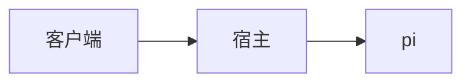
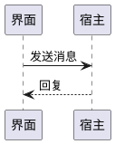

# 回复渲染样例

这一份覆盖 SPEC-0001"回复渲染"的主要范围，用来检查流式输出和一次性渲染的结果一致。图片使用本地数据，不受外网加载或失败时机影响；HTTPS / HTTP 图片策略由 `markdown.browser.test.tsx` 单独覆盖。

## 表格

| 模块     | 职责                | 行数 |
| -------- | ------------------- | ---: |
| protocol | 命令和事件的 schema |  420 |
| host     | 宿主与会话          | 3100 |
| client   | 连接与视图          |  900 |

## 列表

1. 第一步
   - 子项 A
   - 子项 B
     - 更深一层
2. 第二步

- [x] 已完成的任务
- [ ] 未完成的任务

## 代码

```ts
export function add(a: number, b: number): number {
  return a + b;
}
```

```diff
- const old = 1;
+ const next = 2;
```

## 中文与强调

**注意：**加粗紧挨中文标点也要生效；~~删除线~~和*斜体*，还有`行内代码`。

## 公式

行内公式 \(e^{i\pi} + 1 = 0\)，价格 $5 不是公式。

$$
\int_0^1 x^2\,dx = \frac{1}{3}
$$

## 图





## 链接与图片

参见 [Streamdown 文档](https://streamdown.ai/docs)。


## 原始 HTML

<div class="danger">这段 HTML 只显示成文字</div>

> 引用块的最后一行。
